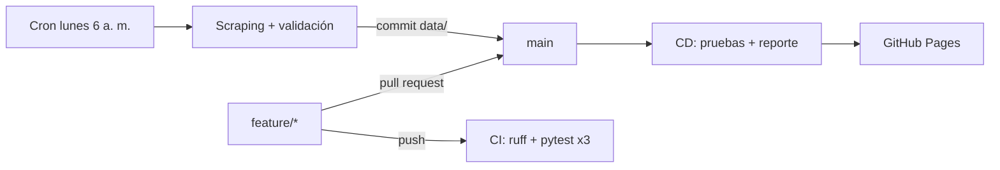

# Precios de tenis para hombre – Tiendas Branchos (DevOps)

Proyecto de la **Evidencia de Aprendizaje 2** de *Programación para Análisis de Datos* (IU Digital de Antioquia, PREICA2602B020048).

Es la continuación de la EA1: en esa evidencia hice el web scraping del catálogo de tenis para hombre de
[Tiendas Branchos](https://www.tiendasbranchos.com/hombres/tenis) con BeautifulSoup, Selenium y Scrapy en un
cuaderno de Colab. Aquí tomé ese código, lo organicé como un proyecto de software con control de versiones en
Git/GitHub y le armé un flujo DevOps con GitHub Actions:

- **CI**: cada push o pull request ejecuta `ruff` y 40 pruebas con `pytest` en Python 3.10, 3.11 y 3.12.
- **Scraping programado**: todos los lunes GitHub Actions extrae el catálogo, valida que esté completo y guarda una foto nueva en `data/historico/`.
- **CD**: cada cambio en `main` vuelve a probar el código, genera el reporte y lo publica en GitHub Pages.

**Reporte publicado:** https://kevinsepulveda-iud.github.io/branchos-precios-devops/

## Flujo de trabajo



| Rama | Para qué la uso |
|------|-----------------|
| `main` | Código estable. Solo recibe cambios por pull request con el CI en verde. |
| `feature/scraping` | Extracción (requests + BeautifulSoup, reintentos, robots.txt). |
| `feature/procesamiento` | Limpieza, indicadores, comparación entre fechas y reporte. |
| `feature/despliegue` | Workflows de CD y scraping programado, Dockerfile. |

Los mensajes de commit siguen el formato `tipo(alcance): descripción` (`feat`, `fix`, `test`, `ci`, `docs`, `data`), como el ejemplo de clase.

## Estructura

```
├── src/branchos/          # paquete con la lógica
│   ├── config.py          # parámetros (categoría, pausa, headers)
│   ├── scraper.py         # extracción JSON-LD + tarjetas VTEX, reintentos y segunda pasada
│   ├── limpieza.py        # precios, descuentos, tipo de calzado y control de calidad
│   ├── analisis.py        # indicadores, resumen por marca, comparación entre fechas
│   └── reporte.py         # sitio estático con gráficos (matplotlib)
├── scripts/
│   ├── extraer.py         # paso 1: scraping + validación -> data/
│   └── publicar.py        # paso 2: data/ -> site/
├── tests/                 # pytest; usa una página real guardada (no necesita internet)
├── data/
│   ├── tenis_branchos_actual.csv
│   ├── ultima_ejecucion.json
│   └── historico/         # una foto por fecha
├── notebooks/             # cuaderno de la EA2 con la explicación paso a paso
├── .github/workflows/     # ci.yml, cd.yml, scraping-programado.yml
└── Dockerfile
```

## Cómo correrlo en local

```bash
git clone https://github.com/kevinsepulveda-iud/branchos-precios-devops.git
cd branchos-precios-devops
pip install -r requirements-dev.txt

ruff check .                 # estilo
pytest                       # pruebas
python scripts/extraer.py    # scraping completo (~4 minutos por la pausa de 1,5 s)
python scripts/publicar.py   # genera site/index.html
```

Para una prueba rápida: `python scripts/extraer.py --paginas 2`.

## Control de calidad

`scripts/extraer.py` termina con error (y el workflow se detiene sin publicar) si:

- se extrajo menos del 95 % de los productos que reporta la tienda (`recordsFiltered`),
- la completitud de nombre, marca, precio y URL es menor al 95 %,
- hay URLs duplicadas o precios en cero.

Esta regla sale de lo que me pasó en la EA1: la primera ejecución se detuvo en la página 8 y casi entrego 84 productos creyendo que era el catálogo completo.

## Ética

Reviso el `robots.txt` antes de extraer, espero 1,5 s entre peticiones, hago una sola petición a la vez y solo tomo información pública (nombre, precio, tallas). El scraping programado corre una vez por semana. Uso académico.

---
Kevin Daniel Sepúlveda Giraldo · Ingeniería de Software y Datos · IU Digital de Antioquia
