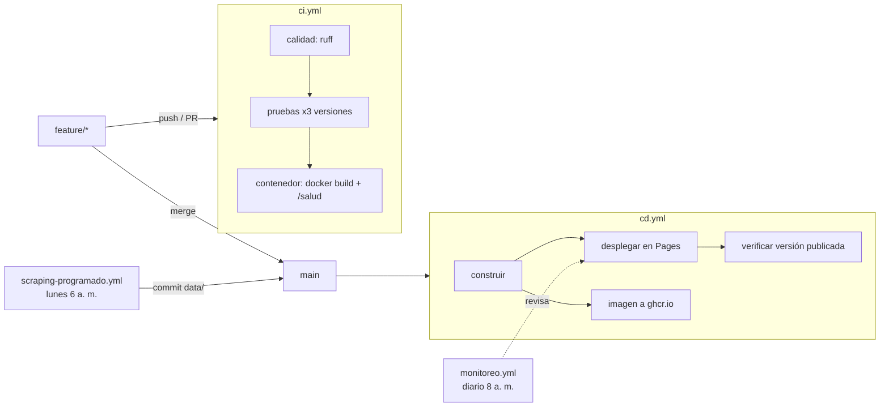

# Precios de tenis para hombre – Tiendas Branchos (DevOps)

Proyecto de *Programación para Análisis de Datos* (IU Digital de Antioquia, PREICA2602B020048) ·
Kevin Daniel Sepúlveda Giraldo y Jessica Serna Vargas (Grupo 9).

| | Enlace |
|---|---|
| **Aplicación web (EA3)** | https://kevinsepulveda-iud.github.io/branchos-precios-devops/app/ |
| Estado del servicio | https://kevinsepulveda-iud.github.io/branchos-precios-devops/app/salud.json |
| Reporte de indicadores (EA2) | https://kevinsepulveda-iud.github.io/branchos-precios-devops/ |
| Imagen Docker | `ghcr.io/kevinsepulveda-iud/branchos-precios` ([paquete](https://github.com/kevinsepulveda-iud/branchos-precios-devops/pkgs/container/branchos-precios)) |
| Ejecuciones del pipeline | [pestaña Actions](https://github.com/kevinsepulveda-iud/branchos-precios-devops/actions) |

## Contenido

1. [Introducción](#1-introducción)
2. [Instalación](#2-instalación)
3. [Uso](#3-uso)
4. [Automatización con GitHub Actions](#4-automatización-con-github-actions)
5. [Despliegue](#5-despliegue)
6. [Estructura del proyecto](#6-estructura-del-proyecto)
7. [Flujo de trabajo con Git](#7-flujo-de-trabajo-con-git)
8. [Ética del scraping](#8-ética-del-scraping)

## 1. Introducción

El proyecto viene de tres evidencias seguidas:

- **EA1**: web scraping del catálogo de [tenis para hombre de Tiendas Branchos](https://www.tiendasbranchos.com/hombres/tenis)
  con BeautifulSoup, Selenium y Scrapy en Colab.
- **EA2**: el código pasó a un paquete de Python en GitHub con pruebas, ramas, pull requests y tres workflows
  (CI, scraping semanal y publicación de un reporte en GitHub Pages).
- **EA3 (esta entrega)**: con las extracciones semanales ya guardadas, construimos una **aplicación web** para buscar
  tenis y ver cómo cambió el precio de cada uno entre extracciones. El pipeline de CI/CD ahora prueba la app,
  la empaqueta en Docker, la despliega en la nube y revisa que el despliegue quedó bien.

La pregunta de negocio sigue siendo la de la EA1: ¿los descuentos de la tienda son reales o el precio tachado es
solo una referencia? Con tres extracciones (9, 16 y 23 de noviembre de 2026) la app ya permite ver, producto por
producto, si el precio subió, bajó o se mantuvo.

## 2. Instalación

Requisitos: Python 3.10 o superior y Git. Docker es opcional.

```bash
git clone https://github.com/kevinsepulveda-iud/branchos-precios-devops.git
cd branchos-precios-devops
pip install -r requirements-dev.txt     # requirements.txt + pytest, pytest-cov y ruff
```

## 3. Uso

### Aplicación web en local (Flask)

```bash
# Linux / macOS
PYTHONPATH=src python -m branchos.web
# Windows (PowerShell)
$env:PYTHONPATH="src"; python -m branchos.web
```

Abre http://localhost:8000. La app tiene buscador, filtros por marca, tipo y precio máximo, orden por descuento o
por cuánto bajó el precio en la semana, y al hacer clic en un producto muestra su historial de precios.

| Ruta | Qué devuelve |
|---|---|
| `/` | la aplicación |
| `/datos/catalogo.json` | catálogo de la última extracción con el historial de cada SKU |
| `/api/productos?q=&marca=&tipo=&max=&orden=` | búsqueda con filtros (`orden`: `descuento`, `variacion`, `precio`, `-precio`) |
| `/api/productos/<sku>` | un producto con su historial (404 si no existe) |
| `/salud` | estado del servicio: versión, fecha de la última extracción y número de productos |

Variables de entorno de la app:

| Variable | Por defecto | Para qué |
|---|---|---|
| `BRANCHOS_DATOS` | `data/` | carpeta con `historico/` |
| `BRANCHOS_VERSION` | `local` | versión que muestra `/salud` (el pipeline pone el SHA del commit) |
| `PORT` | `8000` | puerto del servicio |

### Con Docker

```bash
docker build -t branchos-precios .
docker run --rm -p 8000:8000 branchos-precios
# o la imagen que publica el pipeline:
docker run --rm -p 8000:8000 ghcr.io/kevinsepulveda-iud/branchos-precios:latest
```

### Pipeline de datos (EA2)

```bash
ruff check .                              # estilo
pytest                                    # 53 pruebas
python scripts/extraer.py                 # scraping completo (~3 minutos por la pausa de 1,5 s)
python scripts/extraer.py --paginas 2     # prueba rápida
python scripts/publicar.py --salida site  # reporte + aplicación web estática en site/
```

## 4. Automatización con GitHub Actions



| Archivo | Cuándo corre | Qué hace |
|---|---|---|
| `.github/workflows/ci.yml` | push a `main`, `develop` o `feature/**`, y pull requests | 3 jobs en cadena (`needs`): ruff → pytest en Python 3.10, 3.11 y 3.12 (matriz) → construye la imagen Docker, la arranca y prueba `/salud`, la API y la página |
| `.github/workflows/cd.yml` | push a `main`, fin exitoso del scraping o manual | prueba de nuevo, genera `site/` (reporte + app), despliega en Pages, verifica que el sitio publicado tenga la versión del commit y publica la imagen en ghcr.io |
| `.github/workflows/scraping-programado.yml` | lunes 11:00 UTC (6 a. m. Colombia) o manual | extrae el catálogo, valida cobertura y completitud y hace commit en `data/historico/`; ese commit dispara el CD |
| `.github/workflows/monitoreo.yml` | todos los días 13:00 UTC o manual | pide `salud.json` al sitio publicado y falla si no responde o si los datos tienen más de `MAX_DIAS_DATOS` días |
| `.github/actions/preparar-python/action.yml` | la usan los workflows | acción reutilizable (composite): instala Python con cache de pip y las dependencias |

Conceptos de la Unidad 3 y dónde quedaron:

| Concepto | Dónde |
|---|---|
| Jobs, steps y dependencias entre jobs | `needs:` en `ci.yml` y `cd.yml`; `outputs` para pasar la versión de `construir` a `verificar` e `imagen` |
| Matrices | `strategy.matrix.python-version` en `ci.yml` |
| Acciones reutilizables | `.github/actions/preparar-python` |
| Variables y secretos | `vars.URL_SITIO` y `vars.MAX_DIAS_DATOS` (con valor por defecto), `secrets.GITHUB_TOKEN` para ghcr.io |
| Contextos y expresiones | `github.sha`, `github.repository_owner`, `github.event.workflow_run.conclusion`, `needs.construir.outputs.version`, `if:` |
| Entornos | `github-pages` (despliegue de la app) y `produccion` (imagen Docker) |
| Concurrencia | `ci-${{ github.ref }}` cancela ejecuciones viejas; el CD nunca corta un despliegue a la mitad |
| Monitoreo | `verificar` después de cada despliegue, `monitoreo.yml` diario, resúmenes en `GITHUB_STEP_SUMMARY` y artefactos con los resultados de pytest |

**Control de calidad de los datos.** `scripts/extraer.py` termina con error, y el workflow se detiene sin publicar,
si se extrajo menos del 95 % de los productos que reporta la tienda, si la completitud de nombre, marca, precio y URL
es menor al 95 % o si hay URLs duplicadas o precios en cero. La regla viene de la EA1, donde una ejecución se cortó en
la página 8 y casi entregamos 84 productos creyendo que era el catálogo completo.

## 5. Despliegue

Hay dos formas de desplegar, y las dos salen del mismo código:

**a) GitHub Pages (la app pública).** `scripts/publicar.py` copia `app/` en `site/app/`, escribe
`site/app/datos/catalogo.json` y `site/app/salud.json`, y el job `desplegar` lo publica con
`actions/deploy-pages`. La app filtra en el navegador, así que no necesita un servidor encendido.
Configuración que hicimos una sola vez en el repositorio:

1. *Settings → Pages → Source: GitHub Actions* (desde la EA2).
2. *Settings → Secrets and variables → Actions → Variables*: `URL_SITIO` y `MAX_DIAS_DATOS`.
3. El entorno `github-pages` lo crea GitHub; `produccion` se creó solo la primera vez que corrió el job `imagen`.

**b) Contenedor Docker (la app como servicio con Flask + gunicorn).** El job `imagen` publica
`ghcr.io/kevinsepulveda-iud/branchos-precios` con dos etiquetas: el SHA corto del commit y `latest`.
La imagen corre con un usuario sin privilegios, expone el puerto 8000 y tiene `HEALTHCHECK` contra `/salud`.
Se puede llevar a cualquier servicio que reciba una imagen de contenedor (Azure Container Apps, Google Cloud Run,
Render, etc.); en este proyecto el despliegue público es el de GitHub Pages y el contenedor lo probamos en cada CI
dentro del runner de GitHub.

**Cómo comprobar el despliegue**

```bash
curl https://kevinsepulveda-iud.github.io/branchos-precios-devops/app/salud.json
# {"estado": "ok", "version": "<sha del commit>", "ultima_extraccion": "...", "productos": ...}
```

La versión que aparece ahí y en el pie de la app es el commit que está publicado. Para volver a una versión
anterior basta con revertir el commit en `main` (el CD publica de nuevo) o usar la imagen con la etiqueta de ese SHA.

## 6. Estructura del proyecto

```
├── app/                     # aplicación web (HTML, CSS y JavaScript sin librerías externas)
├── src/branchos/
│   ├── config.py            # parámetros (categoría, pausa, headers)
│   ├── scraper.py           # extracción JSON-LD + tarjetas VTEX, reintentos y segunda pasada
│   ├── limpieza.py          # precios, descuentos, tipo de calzado y control de calidad
│   ├── analisis.py          # indicadores, resumen por marca, comparación entre fechas
│   ├── reporte.py           # reporte estático con gráficos (matplotlib)
│   ├── catalogo.py          # EA3: une las extracciones por SKU con su historial y estado de salud
│   └── web.py               # EA3: servicio Flask (app, API y /salud)
├── scripts/
│   ├── extraer.py           # paso 1: scraping + validación -> data/
│   └── publicar.py          # paso 2: data/ -> site/ (reporte + app)
├── tests/                   # 53 pruebas con pytest (no necesitan internet)
├── data/historico/          # una extracción por fecha
├── notebooks/               # cuadernos de la EA2 y la EA3
├── .github/
│   ├── actions/preparar-python/
│   └── workflows/           # ci.yml, cd.yml, scraping-programado.yml, monitoreo.yml
├── Dockerfile
└── .dockerignore
```

## 7. Flujo de trabajo con Git

`main` solo recibe cambios por pull request con el CI en verde. Cada funcionalidad va en su rama:

| Rama | Evidencia | Contenido |
|---|---|---|
| `feature/scraping` | EA2 | extracción, limpieza y pruebas del scraper |
| `feature/procesamiento` | EA2 | análisis, reporte y primera extracción versionada |
| `feature/despliegue` | EA2 | CD, scraping programado y Dockerfile |
| `fix/grafico-marcas` | EA2 | corrección de la leyenda del gráfico |
| `feature/app-web` | EA3 | aplicación web, servicio Flask, CI con Docker, CD con verificación, imagen en ghcr.io y monitoreo |

Los commits siguen el formato `tipo(alcance): descripción` (`feat`, `fix`, `test`, `ci`, `docs`, `data`, `build`).

## 8. Ética del scraping

Revisamos el `robots.txt` antes de extraer, esperamos 1,5 s entre peticiones, hacemos una sola petición a la vez y
solo tomamos información pública (nombre, precio, tallas). El scraping programado corre una vez por semana.
Uso académico.
